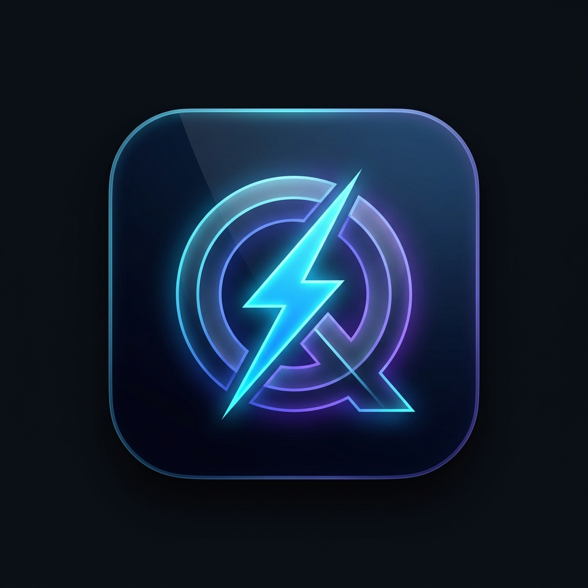

# ⚡ QuickDesk

<div align="center">



**Kişisel Masaüstü Verimlilik ve Geliştirici Yardımcısı**  
*Minimalist, güvenli, ultra-hızlı ve yerel çalışan masaüstü refakatçiniz.*

[](https://www.electronjs.org/)
[](https://react.dev/)
[](https://www.typescriptlang.org/)
[](https://tailwindcss.com/)
[](LICENSE)

[](https://github.com/hoscahmet/Quick-Desk/releases)

<br/>

[Özellikler](#-temel-özellikler) • [Güvenlik & Gizlilik](#-sıfır-bilgi-kriptografi--gizlilik) • [Kurulum & Çalıştırma](#-kurulum--geliştirme) • [Paketleme (Build)](#-dağıtım-ve-paketleme-build) • [Kısayollar](#-klavye-kısayolları)

</div>

---

## 📖 Genel Bakış

**QuickDesk**, geliştiricilerin ve üretkenlik tutkunlarının çalışma akışını bölmeden kod parçacıklarına, notlara, hesap bilgilerine ve sık kullanılan araçlara tek tıkla ulaşmasını sağlayan modern bir masaüstü uygulamasıdır.

Uygulama **%100 çevrimdışı (offline)** çalışır. Hiçbir veriniz harici sunuculara gönderilmez, telemetri veya izleme içermez. İsteğe bağlı olarak tüm verileriniz askeri düzeyde **AES-256-GCM** algoritmasıyla şifrelenir.

---

## 🌟 Temel Özellikler

### 1. 📌 Üstte Sabitleme & Kompakt Mod (Always-on-Top)
- IDE, tarayıcı veya tasarım programlarının üzerinde her an görünür kalabilme.
- Tek tıkla minimalist yapışkan not (`380x520`) boyutuna geçebilme.

### 2. 📝 Hızlı Notlar & Karalama Defteri (Quick Notes)
- Çoklu not oluşturma, anlık arama ve canlı karakter/kelime sayacı.
- Yazarken otomatik arkaplan kaydı (debounced auto-save).
- Tek tıkla panoya kopyalama ve silme.

### 3. 📋 Kod Parçacıkları Kasası (Snippet Vault)
- Git, Docker, CSS, SQL, Bash vb. kod bloklarını etiketleyerek saklama.
- Dil ve kategori bazlı filtreleme, hızlı arama ve tek tıkla panoya kopyalama.

### 4. 🔑 Güvenli Hesap & Parola Yöneticisi (Password Vault)
- Kullanıcı adları, web sitesi bağlantıları, şifreler ve 2FA/kurtarma kodları için güvenli kasa.
- Şifreleri tek tıkla gizleme/gösterme ve doğrudan panoya kopyalama.
- Modal içerisinde dahili **20 karakterlik güçlü parola üreteci**.
- Kategori filtreleri (Geliştirici, Finans, E-posta, Sosyal, İş vb.).

### 5. 🛠️ Geliştirici Araç Kutusu (DevTools)
- **JSON Formatlayıcı**: Sözdizimi doğrulama, Beautify (girintileme) ve Minify (sıkıştırma).
- **Base64 & URL Çevirici**: UTF-8 destekli çift yönlü kodlama ve çözme.
- **Metin Dönüştürücü**: BÜYÜK, küçük, Başlık, camelCase, snake_case, kebab-case ve metin analizi.
- **Üreteçler**: UUID v4, güçlü rastgele parola ve anlık Unix Timestamp.

### 6. ⏱️ Pomodoro Sayacı & Görev Takibi (Focus)
- 25 dk çalışma / 5 dk dinlenme döngüsü (Web Audio API ile yumuşak zil uyarısı).
- Hızlı yapılacaklar listesi (Todo list) ile görev tamamlandıkça üzerini çizme.

### 7. 🌐 Türkçe & İngilizce Çift Dil Desteği
- Header üzerinden anında dil değişimi (`TR` / `EN`).
- Bütün sekmeler, diyaloglar, araçlar ve toast bildirimlerinde eksiksiz yerelleştirme.

### 8. 🌓 Modern Dark & Light Mod
- **Sistem Teması Algılama**: İşletim sisteminizin açık/koyu temasını otomatik takip eder.
- **Linear & Raycast İlhamlı Koyu Tema**: Mor/neon yapay zeka jeneriği renkler yerine, gözü yormayan mat grafit yüzeyler (`#0e1117`, `#181c24`, `#262c3a`) ve elektrik çelik mavisi (`#3b82f6`) aksanlar.

---

## 🔒 Sıfır-Bilgi Kriptografi & Gizlilik

QuickDesk, gizliliğinizi ve verilerinizi en üst düzeyde korur:

- **AES-256-GCM Şifreleme**: Şifre belirlediğinizde tüm notlarınız, parolalarınız ve görevleriniz diske şifreli (`quickdesk-data.json`) olarak yazılır.
- **PBKDF2 Anahtar Türetme**: Parolanız 100.000 döngü SHA-512 ile işlenir; dosyanız ele geçirilse bile kaba kuvvet (brute-force) saldırılarına karşı korunur.
- **Otomatik Kilit (Auto-Lock)**: 2, 5, 15 veya 30 dakika işlem yapılmadığında uygulama kendiliğinden kilitlenir.
- **Veri Konumu**: Tüm veriler sadece kendi cihazınızdaki `~/Library/Application Support/quickdesk/` dizininde yerel olarak tutulur. Proje deposuna hiçbir kişisel veri dahil edilmez.

---

## ⌨️ Klavye Kısayolları

| Kısayol | İşlev |
| :--- | :--- |
| `Cmd/Ctrl + 1` | **Notlar** sekmesine geçiş |
| `Cmd/Ctrl + 2` | **Snippet'lar** sekmesine geçiş |
| `Cmd/Ctrl + 3` | **Hesaplar & Parolalar** sekmesine geçiş |
| `Cmd/Ctrl + 4` | **Geliştirici Araçları** sekmesine geçiş |
| `Cmd/Ctrl + 5` | **Odak & Görevler** sekmesine geçiş |
| `Cmd/Ctrl + N` | Yeni not oluştur |
| `Cmd/Ctrl + P` | Her Zaman Üstte (Pin) modunu aç / kapat |
| `Cmd/Ctrl + L` | Kasayı Anında Kilitle |

---

## 🚀 Kurulum & Geliştirme

Projeyi yerel ortamınızda çalıştırmak için:

```bash
# 1. Depoyu klonlayın
git clone https://github.com/hoscahmet/Quick-Desk.git
cd Quick-Desk

# 2. Bağımlılıkları yükleyin
npm install

# 3. Geliştirme sunucusunu (Hot Reload) başlatın
npm run dev
```

---

## 📦 Dağıtım ve Paketleme (Build)

Uygulamanın çalıştırılabilir paketlerini (`.app`, `.dmg`, `.exe`) üretmek için:

```bash
# Kodları TypeScript ve Vite ile optimize edip out/ klasörüne derler
npm run build

# Derlenmiş üretim sürümünü test etmek için
npm run preview

# macOS için bağımsız çalıştırılabilir .app paketi üretir (dist/mac-arm64/QuickDesk.app)
npm run pack

# macOS için kurulum kalıbı (.dmg) üretir
npm run dist:dmg

# Mac App Store (MAS) için Apple imzalı paket (.pkg) üretir
npm run dist:mas
```

---

## 🛠️ Teknoloji Mimarisi

```
Quick-Desk/
├── electron.vite.config.ts # Vite ve Electron yapılandırması
├── electron-builder.yml    # macOS (.app / .dmg / .mas) paketleme ayarları
├── build/                  # Apple App Store yetki dosyaları (entitlements.mas.plist)
├── resources/              # Uygulama ikonları (PNG & SVG)
├── src/
│   ├── main/               # Electron Ana Süreci (Pencere, AES-256 Şifreleme, IPC)
│   ├── preload/            # Context Bridge Güvenlik Köprüsü
│   └── renderer/           # React 19 Frontend Arayüzü
│       ├── src/
│       │   ├── components/ # Sekmeler, Modal, Kilit Ekranı, Logo
│       │   ├── i18n/       # TR/EN Dil Motoru ve Çeviriler
│       │   ├── theme/      # Dark/Light/System Tema Context
│       │   └── index.css   # Tailwind CSS v4 ve Tema Token'ları
```

---

## 📄 Lisans

Bu proje [MIT](LICENSE) lisansı altında sunulmaktadır. Dilediğiniz gibi kullanabilir, geliştirebilir ve katkıda bulunabilirsiniz.
